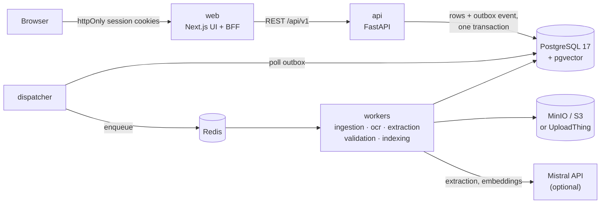

# DocIntel AI

Document intelligence for finance teams. DocIntel ingests invoices, receipts,
scanned PDFs (up to about 1,000 pages), photos and spreadsheets, extracts
structured invoice data with an LLM **without inventing values**, validates
every number deterministically, cross-checks PDFs against other PDFs and
against Excel/CSV registers, and routes anything doubtful to a human reviewer
with the evidence highlighted on the page.

| | |
|---|---|
| **Formats** | PDF (native and scanned), PNG, JPG, TIFF (multi-page), XLSX, XLS, CSV |
| **Extraction** | invoice number, dates, supplier, customer, addresses, currency, subtotal, tax, total, line items; every value grounded in the source text, `null` when not printed |
| **Validation** | line totals, subtotal, tax, total, currency, duplicates (by number and by file hash); `Decimal` arithmetic, absolute tolerance |
| **Cross-verification** | PDF↔PDF and PDF↔Excel/CSV, with evidence from both sides |
| **Review** | corrections with full history, approval, rejection, optimistic locking |
| **Search** | keyword (PostgreSQL full text), semantic (pgvector), hybrid |
| **Measured** | 100% of valid files processed, 31/31 invoices found, field micro-F1 0.992 on a 37-file labeled dataset ([evaluation](docs/evaluation.md)) |

## Architecture



* **Two images.** `backend` holds the API, the five worker pools, the outbox
  dispatcher, the scheduler and migrations: one codebase, one image,
  different commands, each scaled on its own. `frontend` is the Next.js web
  app. They differ in runtime and dependencies, so they are built separately
  and run together from one [`compose.yaml`](compose.yaml).
* **Nothing is lost.** Every stage commits its result and the next stage's
  event in one transaction (transactional outbox). Workers hold leases,
  retries back off, and processed pages are checkpointed.
* **The LLM proposes, rules decide.** Model output is normalized, grounded in
  the page text, cross-checked against a deterministic extractor and
  validated with `Decimal` rules. The model never does arithmetic or approves
  anything.
* **Tokens stay server-side.** The browser talks only to the web app; its BFF
  keeps the session in httpOnly cookies and calls the API.

Full design: [docs/architecture.md](docs/architecture.md) · frontend:
[docs/frontend.md](docs/frontend.md) · database: [docs/database.md](docs/database.md).

## Quick start

**Requirements:** Docker 24+ with Compose v2, `make`, Python 3 (for `make init`).

```bash
git clone <repository-url> docintel && cd docintel
make init          # creates .env from .env.example and generates local secrets
make up            # builds both images and starts everything
```

| Service | URL |
|---|---|
| Web app | <http://localhost:3000> (create an account on the register page) |
| API docs (OpenAPI) | <http://localhost:8000/docs> |
| Health | <http://localhost:8000/health/ready> |

The first start takes a few minutes (images, migrations, buckets). `make ps`
shows the state of every service; `make logs S=api` follows one of them.

**Optional keys** (in `.env`, then `make up` again):

| Key | Effect without it |
|---|---|
| `MISTRAL_API_KEY` | Extraction uses the deterministic rules extractor and search uses local lexical vectors; everything still works offline. With a key, `make init` on a fresh `.env` turns on the hosted providers; in an existing `.env` set `EXTRACTION_PROVIDER=hosted`, `EMBEDDING_PROVIDER=hosted`, `EMBEDDING_MODEL=mistral-embed` and `AI_EXTERNAL_TRANSMISSION_ENABLED=true`. |
| `UPLOADTHING_TOKEN` with `ORIGINALS_STORAGE=uploadthing` | Original files are stored in MinIO. |

Demo data: `make bootstrap` creates an admin account (its password is
printed once) and uploads sample documents.

## Development

```bash
make install       # host toolchains: uv sync (backend) + pnpm install (frontend)
make dev           # stack with API hot reload and PostgreSQL/Redis/MinIO on localhost
make web-dev       # Next.js dev server on :3000 with fast refresh (stop the web container first)
make api-types     # after changing the API: regenerate the frontend's TypeScript types
make help          # every target
```

Each half also works on its own: see [backend/README.md](backend/README.md)
and [frontend/README.md](frontend/README.md).

## Testing

| Command | What it runs |
|---|---|
| `make lint` | ruff + mypy (backend); ESLint, Prettier, TypeScript (frontend) |
| `make test` | backend unit + integration tests against real PostgreSQL, Redis and MinIO (Testcontainers), and frontend unit + component tests (Vitest, MSW) |
| `make test-docker` | both suites inside their Docker images, including the Tesseract OCR tests |
| `make test-e2e` | Playwright workflows and accessibility checks against the running app |
| `make smoke` | end-to-end API check: upload → OCR → extraction → validation → search → reconciliation |
| `make evaluate` | labeled dataset through the running system: accuracy, timing, success and failure rates |

CI ([`.github/workflows/ci.yml`](.github/workflows/ci.yml)) runs the checks
for whichever half changed, plus an **API contract** job that fails when the
frontend's generated types no longer match the backend's OpenAPI schema.
Images are built, scanned with Trivy and pushed by
[`images.yml`](.github/workflows/images.yml).

Latest results: [docs/testing.md](docs/testing.md) · [docs/evaluation.md](docs/evaluation.md).

## Configuration

All settings live in one `.env` at the repository root, documented in
[`.env.example`](.env.example). The ones you are most likely to change:

| Variable | Default | Meaning |
|---|---|---|
| `WEB_PORT` / `API_PORT` | `3000` / `8000` | published ports |
| `APP_ORIGIN` | `http://localhost:3000` | public URL of the web app (CSRF check); change it with the port or domain |
| `COOKIE_SECURE` | `false` | set `true` behind HTTPS |
| `REGISTRATION_MODE` | `open` | `disabled` in production; create admins with `docker compose exec api python -m scripts.create_admin` |
| `EXTRACTION_PROVIDER` / `EMBEDDING_PROVIDER` | `hosted` with a key, else `local` | Mistral or the offline implementations |
| `LLM_MODEL`, `LLM_MAX_CONCURRENCY` | `open-mistral-nemo`, `8` | model and global cap on concurrent LLM calls |
| `ORIGINALS_STORAGE` | `s3` | `uploadthing` stores original files in UploadThing |

Backend settings are defined in
[`backend/app/core/config.py`](backend/app/core/config.py).

## Operations

* **Scale a stage:** `docker compose up -d --scale worker-ocr=4` (likewise for
  `worker-extraction`, `worker-indexing`, …).
* **Migrations:** run automatically on start; `make migrate` runs them on demand.
* **Backups:** `make backup-db`, `make restore-db FILE=backups/<file>.dump`.
* **Failed jobs:** listed in the admin area of the web app
  (`GET /api/v1/admin/dead-letter`); retry with `POST /api/v1/jobs/{id}/retry`.
* **Metrics:** `GET /metrics` (Prometheus, bearer `METRICS_TOKEN`).
* **Re-embed after changing the embedding model:**
  `docker compose exec api python -m scripts.reindex`.
* **Stop:** `make down` keeps the data; `make destroy` deletes it.

## Repository layout

```
.
├── backend/              FastAPI API, Celery workers, migrations, tests, evaluation
│   ├── app/              api · core · modules (documents, parsing, extraction,
│   │                     validation, comparison, reviews, search, jobs, identity) · workers
│   ├── alembic/          database migrations
│   ├── tests/            unit, api, workers, security, integration
│   ├── evaluation/       labeled dataset, generator, evaluation runner, results
│   ├── scripts/          init_env, bootstrap, create_admin, smoke_test, benchmark, reindex, export_openapi
│   └── Dockerfile        one image for API, workers, dispatcher, scheduler, migrations
├── frontend/             Next.js 16 web app (UI + BFF)
│   ├── app/              routes: (auth), (app), bff
│   ├── features/         typed API calls and TanStack Query hooks per domain
│   ├── components/       shared components; ui/ = shadcn/ui
│   ├── tests/ · e2e/     Vitest + MSW; Playwright + axe
│   └── Dockerfile        standalone Next.js server
├── docs/                 architecture, api, database, frontend, testing, evaluation, AI disclosure
├── compose.yaml          the whole system
├── compose.dev.yaml      development overrides
├── Makefile              every task (make help)
└── .env.example          all settings
```

## Documentation

| Document | Contents |
|---|---|
| [architecture.md](docs/architecture.md) | components, pipeline, extraction safeguards, validation rules, scalability, reliability, security, deployment topology |
| [api.md](docs/api.md) | endpoints, errors, upload modes, search, curl walkthrough |
| [database.md](docs/database.md) | schema and indexes |
| [frontend.md](docs/frontend.md) | BFF and session handling, data layer, layout |
| [testing.md](docs/testing.md) | test strategy and latest results |
| [evaluation.md](docs/evaluation.md) | dataset, method, measured accuracy and timing |
| [ai-disclosure.md](docs/ai-disclosure.md) | AI used at runtime, prompts, AI-assisted development |

## AI prompts and AI-assisted development

AI was used in two ways, and both are disclosed:

| What | Where |
|---|---|
| Prompts used to develop the backend | [`backend/ai_prompt_backend.md`](backend/ai_prompt_backend.md) |
| Prompts used to develop the frontend | [`frontend/ai_prompt_frontend.md`](frontend/ai_prompt_frontend.md) |
| Master engineering specification (verbatim and formatted) | [`docs/prompts/`](docs/prompts) |
| Prompts the system sends to the LLM at runtime (extraction, classification) | [`backend/app/modules/extraction/prompts.py`](backend/app/modules/extraction/prompts.py), quoted in [ai-disclosure.md](docs/ai-disclosure.md) |
| Which tools were used, what was reviewed by hand, defects the AI introduced | [ai-disclosure.md](docs/ai-disclosure.md) |

## Submission contents

| # | Deliverable | Where |
|---|---|---|
| 1 | Source code | this repository: [`backend/`](backend), [`frontend/`](frontend) |
| 2 | README and setup instructions | this file ([Quick start](#quick-start)), [backend/README.md](backend/README.md), [frontend/README.md](frontend/README.md) |
| 3 | Architecture diagram and database schema | [Architecture](#architecture), [docs/architecture.md](docs/architecture.md), [docs/database.md](docs/database.md) |
| 4 | Working backend API and frontend | `make up`, then <http://localhost:3000> and <http://localhost:8000/docs>; API reference in [docs/api.md](docs/api.md) |
| 5 | PDF, image, Excel and CSV pipelines | [`backend/app/modules/parsing/`](backend/app/modules/parsing), [`backend/app/workers/`](backend/app/workers); pipeline in [docs/architecture.md](docs/architecture.md) |
| 6 | Automated tests and results | [`backend/tests/`](backend/tests), [`frontend/tests/`](frontend/tests), [`frontend/e2e/`](frontend/e2e); results in [docs/testing.md](docs/testing.md) and [docs/test-results/](docs/test-results); CI in [`.github/workflows/`](.github/workflows) |
| 7 | Evaluation report with measured metrics | [docs/evaluation.md](docs/evaluation.md), raw runs in [`backend/evaluation/results/`](backend/evaluation/results) |
| 8 | Recorded walkthrough | shared with the submission |
| 9 | AI prompts and AI-assisted development | [AI prompts and AI-assisted development](#ai-prompts-and-ai-assisted-development) |

## License notes

PyMuPDF and MinIO are AGPL-licensed. Review licensing before distributing the
images.
