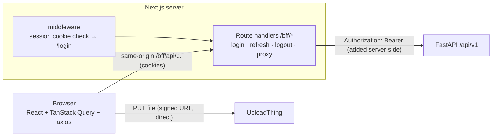

# Frontend plan — DocIntel AI web app

Status: **plan, not built yet.** Every screen below is mapped to an endpoint
that already exists in the backend (`docs/api.md`). The few backend additions
the UI needs are listed in [§10](#10-backend-changes-the-ui-needs).

## 1. Goals

* A clean, minimal internal tool that finance analysts and reviewers can use
  all day: upload → watch processing → check extracted invoices → fix and
  approve → compare and reconcile → search.
* Every backend function reachable from the UI, gated by role.
* **One request per piece of data**: no duplicate fetches, no request
  waterfalls, no polling once a job has finished.
* Light and dark mode with no flash on load, following the system setting by
  default.
* Production-grade: typed end to end, tokens never readable by JavaScript,
  tested, Docker image, works at 1,000-page documents and 10,000-row
  spreadsheets.

Not in scope: public marketing pages, mobile-first layouts (it must work on a
tablet, but it is designed for desktop), i18n (structure allows adding it later).

## 2. Stack

| Concern | Choice | Why |
|---|---|---|
| Framework | **Next.js (App Router, current stable), React 19, TypeScript strict** | Server route handlers give us a secure backend-for-frontend (BFF); file-based routing and layouts |
| Package manager | **pnpm** (version pinned with `packageManager` + Corepack) | Reproducible installs, `pnpm-lock.yaml` committed |
| UI | **shadcn/ui only** (Radix primitives + Tailwind CSS v4), `lucide-react` icons | No second component library; components live in our repo and are themable |
| Theme | **next-themes** + shadcn CSS variables | `class` strategy, system default, no flash of the wrong theme |
| HTTP | **axios**: one instance for browser → BFF | Interceptors for auth refresh, request IDs, error normalisation, upload progress |
| Server state | **TanStack Query v5** | Deduplicates identical requests, caching, polling only while needed, invalidation after mutations |
| URL state | **nuqs** | Filters, pagination, search query and tabs live in the URL (shareable, back button works) and are type-safe |
| Forms | **react-hook-form + zod** (shadcn `Form`) | Same validation rules as the API (password ≥ 12 chars, etc.) |
| Tables | **TanStack Table** with shadcn `Table`; **TanStack Virtual** for long lists | Server-side pagination and sorting; virtualised findings, rows and pages |
| Charts | **shadcn Charts** (Recharts) | Dashboard only |
| Toasts | **sonner** (shadcn) | |
| Upload drop zone | **react-dropzone** | Validates type and size before any request |
| Document viewer | page images from the API (see §10) with an absolutely positioned evidence overlay | Same viewer for PDF, scans, PNG/JPG and multi-page TIFF; no pdf.js bundle |
| API types | **openapi-typescript** generated from `/openapi.json` into `src/lib/api/schema.d.ts` | Frontend types cannot drift from the backend; CI fails if regeneration changes the file |
| Dates and money | `date-fns`; money stays a **decimal string** and is formatted with `Intl.NumberFormat` without converting to float for arithmetic | The API never sends floats; the UI must not introduce rounding |
| Tests | **Vitest** + Testing Library + **MSW**; **Playwright** end to end against the real Docker stack; `@axe-core/playwright` | |
| Quality | ESLint (next + typescript-eslint strict), Prettier + tailwind plugin, `tsc --noEmit`, bundle analyzer | |

## 3. Architecture



### 3.1 Authentication: backend-for-frontend, tokens in httpOnly cookies

The API returns `access_token` + `refresh_token` in the JSON body. The browser
must never hold them (an XSS bug would then leak a 14-day refresh token).

* `POST /bff/auth/login` → calls `POST /api/v1/auth/login`, stores
  `di_at` (access, 15 min) and `di_rt` (refresh, path `/bff/auth`) as
  `httpOnly; Secure; SameSite=Lax` cookies, and returns only `{ok, expires_at}`.
* `ALL /bff/api/[...path]` → a streaming proxy: copies method, query, body
  (streamed, so uploads and CSV/ZIP downloads are not buffered), `Idempotency-Key`,
  `If-Match`-style headers and `X-Request-ID`; adds `Authorization` from the
  cookie; passes status, body and safe headers back. It **never refreshes**
  by itself (see below).
* `POST /bff/auth/refresh` → rotates the tokens and resets both cookies.
* `POST /bff/auth/logout` → calls the API logout (optionally
  `all_sessions=true`) and clears the cookies.
* `middleware.ts` redirects to `/login?next=…` when there is no session cookie;
  role checks happen in the layouts using `/auth/me`.
* CSRF: cookies are `SameSite=Lax`, and the proxy rejects state-changing
  requests whose `Origin` is not the app's origin or that lack the
  `X-Requested-With: docintel` header that the axios instance always sends.
* No CORS is needed because the browser only talks to its own origin.
  `CORS_ALLOWED_ORIGINS` can then stay empty in production.

### 3.2 Token refresh without logging users out

The backend rotates refresh tokens and **revokes the whole session if a
rotated token is reused**. Two requests (or two tabs) refreshing at the same
time would therefore log the user out. Rules:

1. Only the axios response interceptor refreshes, on `401` with
   `error.code === "TOKEN_EXPIRED"`. Other 401 codes (`TOKEN_INVALID`,
   `REFRESH_REUSED`, `ACCOUNT_DISABLED`) go straight to `/login`.
2. **Single flight in one tab**: one shared `refreshPromise`; every request
   that gets a 401 while it is pending waits for it and then retries once.
3. **Single flight across tabs**: the refresh runs inside
   `navigator.locks.request("docintel-refresh", …)`. After acquiring the lock
   it reads the readable `di_at_exp` cookie (expiry only, no secret); if
   another tab already refreshed, it skips the call.
4. **Proactive refresh**: a timer refreshes about 60 s before `di_at_exp`
   while the tab is visible, so most users never see a 401 at all.
5. Logout in one tab broadcasts on a `BroadcastChannel` so other tabs clear
   their query cache and go to `/login`.

### 3.3 Data layer rules (no duplicate fetching)

* **One axios instance** (`src/lib/api/client.ts`): `baseURL: "/bff/api/v1"`,
  `X-Requested-With`, generated `X-Request-ID`, 30 s timeout (none for
  uploads), and the refresh interceptor above.
* **Error normalisation**: every failure becomes
  `ApiError {status, code, message, requestId, details, retryAfter}` from the
  backend envelope `{"error": {...}}`. The UI shows `message` and offers to
  copy `requestId` for support.
* **Thin typed services per module**, `src/features/*/api.ts`, using the
  generated types, e.g. `documentsApi.list(params)`. Components never call
  axios directly.
* **Query-key factory** (`src/lib/api/keys.ts`), one place for all keys:
  `qk.documents.list(filters)`, `qk.documents.detail(id)`,
  `qk.jobs.detail(id)`, `qk.invoices.detail(id)`, … The same key always means
  the same request, so TanStack Query deduplicates it.
* **Defaults**: `staleTime: 30s`, `gcTime: 5min`, `retry` only for network
  errors, 5xx and 429 (honour `Retry-After`) at most twice, never for 4xx;
  `refetchOnWindowFocus` only for lists.
* **Polling only while something is running.** Jobs poll with
  `refetchInterval: (q) => isTerminal(q.state.data?.state) ? false : backoff`
  (1 s → 2 s → 5 s, paused when the tab is hidden). When a job reaches a
  terminal state, the cache invalidates exactly the dependent keys (document,
  invoices, validations, review queue count). Lists that contain running jobs
  poll the list, not each row.
* **Detail pages seed from lists**: `initialData` from the list cache plus
  `placeholderData: keepPreviousData` on paginated tables, so going back and
  forth never shows a spinner for data we already have.
* **Prefetch on intent**: hovering or focusing a row prefetches its detail.
* **Mutations** declare what they invalidate in one map
  (`src/lib/api/invalidation.ts`) instead of calling `invalidateQueries`
  ad hoc.
* **Optimistic concurrency**: corrections, approve and reject send
  `expected_version`. A `409 VERSION_CONFLICT` shows a "This invoice changed"
  dialog with the latest version and a field diff, never a silent overwrite.
* **Idempotency**: uploads, comparisons and reconciliations send an
  `Idempotency-Key` generated once per user action (`crypto.randomUUID()`), so
  a double click or a network retry cannot create two jobs. Submit buttons
  are also disabled while the mutation is pending.
* React StrictMode stays on; TanStack Query makes the double mount in
  development harmless.

## 4. Project structure

```
frontend/
  src/
    app/
      (auth)/login/page.tsx            register/page.tsx (only when registration is open)
      (app)/layout.tsx                 shell: sidebar, top bar, command menu, auth gate
      (app)/page.tsx                   dashboard
      (app)/documents/...              list, [id] with tabs
      (app)/invoices/[id]/page.tsx     invoice workspace (review)
      (app)/reviews/page.tsx           review queue
      (app)/jobs/...                   list, [id]
      (app)/compare/...                comparisons and reconciliations
      (app)/search/page.tsx
      (app)/admin/...                  users, failed jobs, audit log, system health
      bff/auth/{login,refresh,logout}/route.ts
      bff/api/[...path]/route.ts       streaming proxy
      layout.tsx  providers.tsx  globals.css  error.tsx  not-found.tsx
    components/ui/                     shadcn components (generated, then owned)
    components/                        app-wide: data-table, status-badge, money, empty-state,
                                       page-header, confirm-dialog, json-diff, theme-toggle
    features/<module>/                 api.ts · hooks.ts · components/ · schemas.ts
                                       (auth, documents, upload, jobs, invoices, reviews,
                                        comparisons, search, admin)
    lib/api/                           client.ts · errors.ts · keys.ts · invalidation.ts · schema.d.ts
    lib/                               auth (cookies, refresh lock), format (money, dates, bytes),
                                       permissions, env (zod-validated)
    middleware.ts
  tests/  e2e/ (Playwright)  unit/ (Vitest)  msw/
  Dockerfile  next.config.ts  components.json  package.json  pnpm-lock.yaml
```

Rule: `app/` contains only routing and layout; screens are composed from
`features/*`; `features` never import from each other except through their
`index.ts`.

## 5. Screens and the endpoints behind them

Role gates follow `GET /auth/me` → `permissions`. Hidden actions are hidden,
not just disabled; the API still enforces everything.

| Route | What the user does | Endpoints |
|---|---|---|
| `/login`, `/register` | Sign in; create the organization (only if registration is open) | `POST /auth/login`, `/auth/register`, `GET /auth/me` |
| `/` Dashboard | Counts by status, open reviews, failed tasks, recent documents and running jobs | `GET /admin/stats` (admins), `GET /documents?limit=8`, `GET /jobs?state=…` |
| `/documents` | Table with filters (status, type, file kind, filename, date range), upload button, bulk select | `GET /documents` |
| Upload sheet | Drop up to 20 files, see per-file progress, duplicate warnings and rejections | `POST /documents/direct-uploads` → `PUT upload_url` → `POST …/complete`; fallback `POST /documents/upload` |
| `/documents/[id]` | Header (status, type, pages, validation outcome) and tabs: **Invoices · Pages · Text · Tables · Issues · Jobs**; download, reprocess, delete | `GET /documents/{id}`, `/invoices`, `/pages`, `/text`, `/tables`, `/tables/{t}/rows`, `/validations`, `/documents/{id}/jobs`, `/download`, `POST /reprocess`, `DELETE` |
| `/invoices/[id]` | **Review workspace**: page viewer with evidence boxes on the left; fields, line items, issues and history on the right; edit, approve, reject, revalidate | `GET /invoices/{id}`, `/line-items`, `/validations`, `/history`, `PATCH /corrections`, `POST /approve`, `/reject`, `/revalidate` |
| `/reviews` | Queue (open, mine, unassigned), claim, open the next task | `GET /reviews/queue`, `GET /reviews/{id}`, `POST /reviews/{id}/claim` |
| `/jobs`, `/jobs/[id]` | Job list; detail with stage timeline, page progress, failed tasks and error history; retry, cancel | `GET /jobs`, `GET /jobs/{id}`, `POST /retry`, `POST /cancel` |
| `/compare` | Lists of comparisons and reconciliations | `GET /comparisons` |
| `/compare/new` | Wizard: **PDF ↔ PDF** (pick two documents, optionally invoices, options) or **PDF ↔ Spreadsheet** (pick PDFs and a sheet, review the suggested column mapping) | `POST /comparisons`, `GET /documents/{id}/spreadsheet/mapping-suggestions`, `POST /reconciliations` |
| `/compare/[id]` | Summary cards (matched, mismatched, missing on each side, ambiguous, duplicate), findings table with side-by-side values and evidence links, CSV export | `GET /comparisons/{id}` or `/reconciliations/{id}`, `/findings`, `/export.csv` |
| `/search` | One box with a **Keyword · Semantic · Hybrid** switch, filters, highlighted snippets, jump to the page | `GET /search/keyword`, `POST /search/semantic`, `POST /search/hybrid` |
| `/admin/users` | Invite (create) users, change role, deactivate, revoke sessions | `GET/POST /users`, `PATCH /users/{id}`, `POST /users/{id}/revoke-sessions` |
| `/admin/failed-jobs` | Dead-letter list with error history and replay | `GET /admin/dead-letter`, `POST /jobs/{id}/retry` |
| `/admin/audit` | Append-only audit log, filterable | `GET /admin/audit-events` |
| `/admin/system` | Live readiness of database, Redis and storage | `GET /health/ready` (through the proxy) |
| Account menu | Theme, sign out, sign out everywhere | `POST /auth/logout?all_sessions=true` |

## 6. Key flows in detail

### 6.1 Upload

1. Validate in the browser: allowed extensions (PDF, PNG, JPG, TIFF, XLSX,
   XLS, CSV), at most 20 files, size limit (from a config endpoint, see §10).
   The server still checks content signatures.
2. For each file, in parallel with a limit of 3:
   `POST /documents/direct-uploads {filename, size}` → `PUT upload_url`
   (multipart field `file`, axios `onUploadProgress` → progress bar) →
   `POST complete_url`. Large files never pass through the Next.js server.
3. If direct upload returns `409 DIRECT_UPLOAD_UNAVAILABLE` (S3 mode), fall
   back to `POST /documents/upload` through the streaming proxy, with one
   `Idempotency-Key` for the batch.
4. Each row shows: queued → uploading % → verifying → processing (job
   progress) → done, rejected (with the API's reason, e.g. "Encrypted PDF"),
   or duplicate (with a link to the existing document).
5. Closing the sheet does not cancel anything; a small "N uploads in
   progress" indicator stays in the top bar.

### 6.2 Processing status

* The job badge and progress bar come from `GET /jobs/{id}`
  (`state`, `progress_percent`, `pages_completed/pages_total`).
* The job detail shows the stage timeline (`stage_history_json`), task counts
  by state, and failed tasks with each attempt's error code and message.
* States map to a fixed set of badge colours shared everywhere
  (`components/status-badge.tsx`): running = blue, completed = green, with
  warnings = amber, requires review = violet, failed or cancelled = red or grey.

### 6.3 Invoice review workspace (the most important screen)

* **Left: page viewer.** Page thumbnails (virtualised, so 1,000 pages are
  fine) and the selected page image. Clicking a field draws its evidence box:
  `bounding_box` is in page coordinates, so the overlay is
  `bbox / page_width × rendered width` (`page_width`/`page_height` come from
  the page metadata). Spreadsheet evidence shows sheet, row and cell instead.
* **Right: fields.** Each field shows its value, a support marker
  (supported / weak / unsupported), corrected fields marked with the original
  machine value, and alternatives when the extractors disagreed.
* **Edit mode**: a form over the invoice fields and line items
  (add, edit, remove rows). Saving sends only the changed paths as
  `changes[]` plus `expected_version` and a required reason. The response's
  `revalidation_job_id` is polled; issues refresh when it finishes.
* **Issues panel**: severity, rule code, message, expected vs actual values,
  and a link that highlights the evidence.
* **Approve**: blocked while revalidation runs (`409 REVALIDATION_PENDING`).
  With open errors (`409 BLOCKING_ISSUES`) the dialog lists them and requires
  "acknowledge issues" plus a reason.
* **Reject**: requires a reason (at least 3 characters).
* **Keyboard**: `j`/`k` next and previous field, `e` edit, `a` approve,
  `]` next task in the queue.
* **History tab**: who changed what, when, and why (`/invoices/{id}/history`).

### 6.4 Comparison and reconciliation

* A wizard built from shadcn `Tabs` and `Form`: choose a mode, pick
  documents with a searchable combobox (`GET /documents?filename=`), set
  options (amount tolerance, fuzzy supplier threshold).
* Reconciliation: once a spreadsheet is picked, load the mapping suggestions
  and show a column → field mapping table with the required fields marked.
  `422 INVALID_COLUMN_MAPPING` highlights the missing fields with the
  suggestions from `details`.
* Results: summary cards, then a findings table filterable by status, record
  rows expandable to per-field differences, evidence links that open the PDF
  page or sheet row. The CSV export is a plain link through the proxy, so
  nothing is buffered in the browser.
* A comparison marked `STALE` (an invoice was corrected afterwards) shows a
  banner with a "Run again" action.

### 6.5 Search

* The query, mode, filters and page live in the URL (`nuqs`); input is
  debounced 300 ms, and the request fires only for a non-empty query, so
  `422 EMPTY_QUERY` cannot happen.
* Snippets come back with `«` `»` around matches; they are split into text
  and `<mark>` elements, **never** injected as HTML.
* Results show filename, type, score (labelled by `score_kind`, never
  presented as a percentage), matched pages, and link to
  `/documents/[id]?tab=text&page=n`.

## 7. Design system

* **Look**: neutral, quiet, dense enough for data work. shadcn `new-york`
  style, `zinc` base, one accent colour; Inter (or Geist) via `next/font` with
  tabular numbers for all amounts.
* **Tokens only**: colours come from CSS variables defined for `:root` and
  `.dark` in `globals.css`; no hard-coded colours in components. Status colours
  are tokens too (`--status-success`, `--status-warning`, …), checked for
  WCAG AA contrast in both themes.
* **Dark mode**: `next-themes` with `attribute="class"`, `defaultTheme="system"`,
  `disableTransitionOnChange`, and `suppressHydrationWarning` on `<html>`, so
  there is no flash of the wrong theme. The theme toggle sits in the account
  menu and the command menu.
* **Layout**: collapsible sidebar (shadcn `Sidebar`), top bar with
  breadcrumbs, a global upload indicator and the command menu (`⌘K`: jump to
  a document, invoice, page or action).
* **Every data view has four states**, designed once and reused:
  loading (`Skeleton` that matches the final layout, so nothing jumps),
  empty (explains what to do next), error (message, request ID, retry), and
  data. Route-level `error.tsx` and `not-found.tsx` too.
* **Feedback**: `sonner` toasts for completed actions; destructive actions
  (delete, reject, revoke sessions) use `AlertDialog` confirmation.
* **Formatting helpers** used everywhere: `<Money value="1234.50" currency="EUR"/>`,
  `<DateTime/>` (local time, UTC on hover), `<Bytes/>`, `<StatusBadge/>`.
* **Accessibility**: Radix gives focus management and keyboard support; we
  add visible focus rings, labels on icon buttons, and `aria-live` for job
  progress. `axe` runs in Playwright on every page.

shadcn components used: button, input, textarea, label, form, select,
combobox (command + popover), checkbox, switch, radio-group, tabs, table,
card, badge, dialog, alert-dialog, sheet, drawer, dropdown-menu, context-menu,
tooltip, hover-card, popover, command, sidebar, breadcrumb, pagination,
progress, skeleton, separator, scroll-area, resizable, accordion, collapsible,
calendar + date picker, sonner, chart, alert, avatar.

## 8. Performance

* Route-level code splitting by default; the review workspace and charts are
  loaded with `next/dynamic` only where they are used.
* Large lists are virtualised (pages, findings, spreadsheet rows, line items
  over 100 rows); everything else is paginated on the server (`limit` /
  `offset`).
* Page images are loaded lazily, at thumbnail size for the strip and full
  size only for the open page, and cached by the browser (`Cache-Control`
  from the API).
* Budgets checked in CI: initial JavaScript for the app shell under about
  200 KB gzip, Lighthouse performance ≥ 90 on the documents list, and
  interaction to next paint under 200 ms on the review screen.

## 9. Security

* Tokens are only in `httpOnly` cookies; `Secure` in production.
* Content Security Policy with nonces (set in `middleware.ts`):
  `default-src 'self'`, `img-src 'self' blob: data:`, `connect-src 'self'`
  plus the UploadThing ingest host, `frame-ancestors 'none'`. Also
  `Referrer-Policy`, `X-Content-Type-Options`, `Permissions-Policy`.
* No `dangerouslySetInnerHTML` anywhere (lint rule).
* The proxy forwards only to the configured `API_INTERNAL_URL`, only under
  `/api/v1` and `/health`; it strips hop-by-hop headers and never forwards
  incoming `Authorization` or cookie headers to the API.
* Environment variables are validated with zod at startup; only
  `NEXT_PUBLIC_*` values that are not secret reach the browser.
* Query cache is cleared on logout and on a user switch.

## 10. Backend changes the UI needs

Small and additive; each one gets tests in the backend suite.

1. **`GET /documents/{id}/pages/{n}/image?width=`**: render one page as
   PNG/WebP (PyMuPDF already handles PDF and TIFF; images are resized), with
   `Cache-Control: private, max-age=…` and an ETag. Needed for the review
   viewer, and avoids pdf.js plus a TIFF decoder in the browser.
2. **`page_width` / `page_height` in `PageOut`** (they are in
   `metadata_json` today; expose them as fields so the overlay maths is typed).
3. **`GET /config/public`**: upload limits, allowed extensions, whether
   registration is open, whether direct upload is available. This stops the UI
   from hard-coding backend settings.
4. **Optional, recommended**: a 10–20 s grace window on refresh-token reuse
   (return the already-issued successor instead of revoking the family). The
   client-side single flight (§3.2) avoids the problem; the grace window makes
   flaky networks safe as well.
5. **Optional**: Server-Sent Events for job progress. Polling with back-off
   is enough for now; the data layer is written so SSE can replace polling
   without changing components.

## 11. Testing

| Level | Tool | What |
|---|---|---|
| Unit | Vitest | money and date formatting, error normalisation, query keys, refresh single flight (concurrent 401s → exactly one refresh), invalidation map, correction diff builder, snippet highlighter |
| Component | Testing Library + MSW | upload sheet states, review workspace (edit → save → version conflict dialog), approve with blocking issues, search URL state, every empty/error/loading state |
| End to end | Playwright against `docker compose` | login → upload PDF + XLSX → wait for completion → open invoice → correct a total → approve → reconcile → export CSV → search; role checks (viewer cannot upload); two tabs refreshing at once stay logged in; light and dark screenshots |
| Accessibility | `@axe-core/playwright` | every route, both themes, no serious violations |
| Network discipline | Playwright request log | opening each page issues each request once; no requests after jobs finish |

CI (`.github/workflows/frontend.yml`): `pnpm install --frozen-lockfile` →
lint → typecheck → check that the OpenAPI types are up to date → unit and
component tests → build → Playwright against the stack.

## 12. Deployment

* `output: "standalone"`, multi-stage Dockerfile (pnpm fetch → build →
  `node:…-alpine` runtime, non-root, read-only filesystem, health check on
  `/bff/health`).
* Added to `compose.yaml` as `web` on port 3000, with `API_INTERNAL_URL=http://api:8000`
  on the internal network. The browser only ever sees the web origin.
* Environment: `API_INTERNAL_URL`, `APP_ORIGIN`, `COOKIE_SECURE`,
  `NEXT_PUBLIC_APP_NAME`.

## 13. Delivery phases

Each phase ends with working screens, tests, and a demo against the real stack.

| Phase | Scope | Done when |
|---|---|---|
| 0. Foundation | Scaffold (pnpm, Next.js, Tailwind v4, shadcn init), theme, app shell, BFF auth with cookies and refresh single flight, axios + Query setup, OpenAPI types, error/empty/loading components, CI | Login and logout work, the theme persists without a flash, two tabs stay signed in across token expiry |
| 1. Backend additions | §10 items 1–3 | Backend tests pass, OpenAPI regenerated |
| 2. Documents and upload | Documents list with URL filters, upload sheet (direct + fallback), document detail tabs, jobs list and detail, retry, cancel, reprocess, delete | All 7 file types upload and show live progress; failed jobs can be retried from the UI |
| 3. Review | Invoice workspace with viewer and evidence overlay, corrections, approve and reject, review queue with claim and next task | A reviewer can fix and approve every invoice in the evaluation dataset without leaving the screen |
| 4. Compare and search | Comparison and reconciliation wizard, results, CSV export, search with three modes and filters, command menu | Evaluation scenarios (PDF↔PDF price change, PDF↔Excel register) reproduce in the UI |
| 5. Admin and dashboard | Users, failed jobs, audit log, system health, dashboard charts | Admin-only routes hidden for other roles and rejected by the API |
| 6. Hardening | Playwright suite, axe, performance budgets, CSP, Docker image, compose service, README section | CI green; Lighthouse and axe budgets met in both themes |

## 14. Definition of done (every screen)

* Typed against generated API types; no `any`.
* Loading, empty, error and data states implemented and tested.
* Works in light and dark mode, keyboard-only, and at 1280 px and 768 px wide.
* Each request fires once per view; polling stops at terminal states.
* Role gating matches `docs/api.md`.
* Errors show the API message and request ID; nothing is swallowed.
