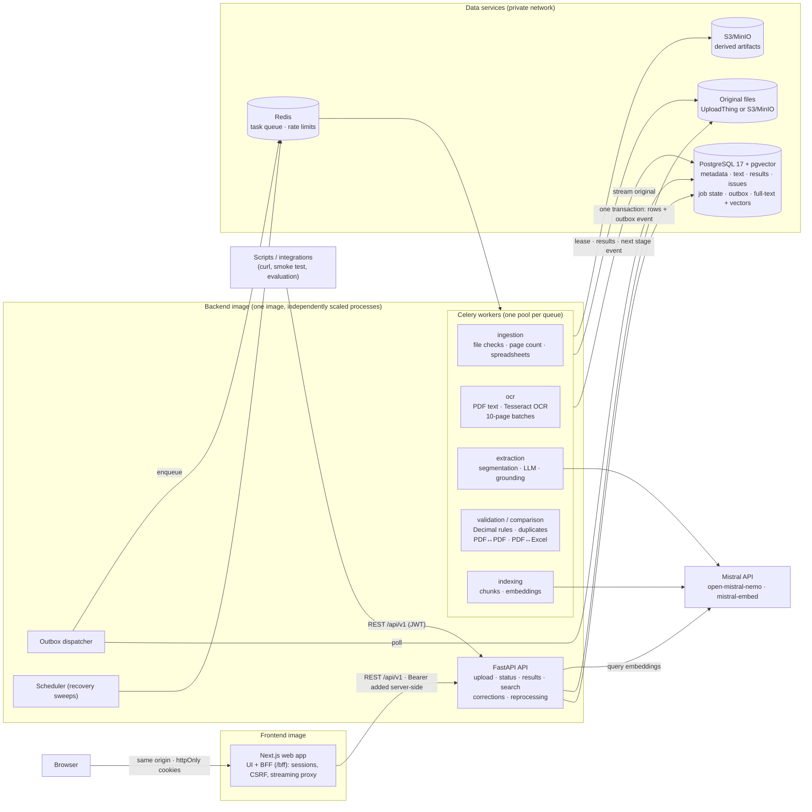

# Architecture

## Diagram



## Technology choices

| Requirement | Choice | Why |
|---|---|---|
| Web app | **Next.js 16** + shadcn/ui, TanStack Query | Server-side BFF keeps tokens out of the browser; one origin for the UI; details in [frontend.md](frontend.md) |
| Backend API | **FastAPI** (instead of NestJS) | The whole document stack (PyMuPDF, Tesseract, OpenCV, openpyxl, xlrd) is Python; one language for API and workers means one domain model and no cross-service contracts. Async I/O, Pydantic validation, OpenAPI for free |
| Background jobs | **Celery + Redis** (the Python equivalent of BullMQ) | Separate queues per stage so OCR, LLM and indexing scale independently |
| Database | **PostgreSQL 17** | Relational integrity for financial data, `NUMERIC` money, JSONB for evidence, transactions for the outbox |
| Vector database | **pgvector** in the same PostgreSQL | No second datastore to secure or keep consistent; tenant filters and vectors in one query; HNSW index |
| OCR | **Tesseract 5** (via pytesseract) + OpenCV preprocessing | Runs everywhere in the image (incl. ARM); orientation detection, word boxes, confidences |
| Native PDF text | **PyMuPDF** | Fast, page-level access, word coordinates for evidence bounding boxes, table detection |
| Spreadsheets | **openpyxl** (read-only streaming), **xlrd** (XLS), stdlib **csv** | Bounded memory on large workbooks; pandas would load whole sheets into memory |
| LLM | **Mistral** (`open-mistral-nemo`) via an OpenAI-compatible adapter with strict JSON schema | Structured output; the adapter is provider-neutral (any OpenAI-compatible endpoint) |
| Embeddings | **mistral-embed** (1024-dim) | Semantic search; a deterministic local embedding exists for offline tests only |
| File storage | **UploadThing** (raw originals) or **S3/MinIO** | Originals are kept byte-for-byte outside the database |

## Processing pipeline

```
UPLOAD (API)        content-signature check · size/quota · SHA-256 · store original · create job   → 202
PREPROCESS          integrity check of stored file · page count · split into 10-page batches
PARSE (parallel)    per page: native text if usable, else render + OCR (deskew/contrast/denoise only when needed)
                    spreadsheets: every sheet, header detection, every row with sheet/row/cell coordinates
EXTRACT             classify (rules) → segment pages into invoices → LLM per segment (parallel, bounded)
                    → normalize (Decimal, ISO dates, ISO currency) → ground each value in the source text
VALIDATE            deterministic rules (Decimal) → issues with expected/actual/formula → review tasks
INDEX               text chunks + metadata chunk → full-text vector + embedding
DONE                COMPLETED · COMPLETED_WITH_WARNINGS · REQUIRES_REVIEW · FAILED
```

Every stage is a database task with a **lease**; a stage commits its results,
its completion, the job's state transition and the next stage's event in **one
transaction**. Job progress (`progress_percent`) is computed from completed
work units and reaches 100% only at a successful end state.

### Extraction without invented values
* The LLM receives page text wrapped in markers, is told the text is untrusted
  data, has no tools, and must return a **strict JSON schema** in which every
  value is a string *as printed* plus the page and a verbatim evidence snippet.
* Values are normalized deterministically (no model arithmetic). Ambiguous
  dates (`03/04/2026`), ambiguous separators (`1,234`) and ambiguous currency
  symbols (`$`, `¥`) are **flagged, never guessed**.
* Currency is the `CurrencyCode` enum (55 ISO 4217 codes, `backend/app/shared/enums.py`)
  everywhere: extraction output, the `invoice_records.currency` CHECK constraint,
  corrections, search filters, comparison options and the API schema. A bare
  `$` with no country evidence stays `null` with `currency_raw: "$"` and an
  `INVALID_CURRENCY` warning listing the candidate codes; it is never defaulted.
  Adding a code means adding its minor units and a migration for the constraint.
* **Grounding**: each value must be found on the cited page; the matching line
  and its bounding box become the evidence. Values that cannot be found are
  marked `UNSUPPORTED` and raise `UNGROUNDED_VALUE`.
* Values printed over several lines of one column (an address next to an
  "Invoice details" column) are matched cell by cell, so they are grounded
  without accepting text that mixes columns.
* Missing information is `null`.
* **Two independent extractors, cross-checked.** The deterministic layout
  extractor (about 0.2 s per document) runs next to the LLM on every
  segment. Where the LLM's amounts or line items do not add up but the
  rules' do, the arithmetically consistent version is used; a field the LLM
  left empty or could not ground is taken from the rules if the rules' value
  is found in the source. Each substitution is recorded
  (`CROSS_CHECK_APPLIED`), and remaining disagreements are kept as
  alternatives (`EXTRACTOR_DISAGREEMENT`). This targets the LLM errors seen in
  evaluation: line-item amounts read as shipping, and lines dropped on
  multi-page invoices.
* If the LLM cannot process a segment (invalid output twice, request
  rejected) or finds nothing, the rules' result is used and flagged
  `EXTRACTION_FALLBACK`.
* Long documents: pages are segmented into invoices (header/number changes,
  "page 2 of 3", "continued"), segments are extracted in parallel, long
  segments are split into token-budget windows and merged.

### Validation rules (deterministic, Decimal)
`REQUIRED_FIELD_MISSING` · `INVALID_DATE` · `INVALID_CURRENCY` ·
`CURRENCY_CONFLICT` · `LINE_TOTAL_MISMATCH` (qty × price − discount) ·
`SUBTOTAL_MISMATCH` (Σ lines) · `TAX_MISMATCH` (only rates printed on the
document) · `TOTAL_MISMATCH` (subtotal − discount + shipping + tax) ·
`NEGATIVE_AMOUNT` (credit-note aware) · `DUPLICATE_INVOICE` (same supplier +
number in another document) · `DUPLICATE_FILE` (SHA-256) ·
`UNGROUNDED_VALUE` · `AMBIGUOUS_VALUE` · `LOW_EXTRACTION_CONFIDENCE` ·
`UNSUPPORTED_CALCULATION` · `CURRENCY_INFERRED` (INFO: `$`/`¥`/`kr` resolved from the supplier's printed address, e.g. "CA 94107" → USD; never without that evidence) · `PDF_REPAIRED` (damaged PDF recovered, content
may be incomplete) · `EXTRACTION_FALLBACK` · `EXTRACTOR_DISAGREEMENT`.
Absolute tolerance (0.01), never percentages. Any
ERROR, or a review-relevant warning, sets the invoice to `REQUIRES_REVIEW` and
opens a review task.

### Cross-verification
PDF↔PDF and PDF↔Excel/CSV use the same matcher: same normalized invoice
number, compatible supplier ("A.B.C. Limited" = "ABC Ltd"; a different
supplier with the same number is *not* a match), disambiguation by date and
total, and amounts compared only in the same currency. Results are `MATCH`,
`MISMATCH`, `MISSING_LEFT` / `MISSING_RIGHT` (missing in PDF / in the sheet),
`AMBIGUOUS` (never silently resolved), `NOT_COMPARABLE`, `DUPLICATE`, each with
evidence from both sides (page + bounding box, or sheet + row + cell).

## Scalability

* The API does no heavy work; OCR, LLM and indexing run in **separate worker
  pools**, each scaled on its own (`docker compose up --scale worker-ocr=4`).
* A 1,000-page PDF becomes 100 independent page-batch tasks that spread
  across all OCR workers. Each page is processed and committed one at a time,
  so memory stays flat (peak about 620 MiB for an OCR worker with 2 processes).
* LLM calls for a document's invoices run in parallel, capped per worker and
  globally (Redis semaphore) to respect provider rate limits.
* PostgreSQL indexes: partial indexes on active jobs, unpublished events and
  open issues; GIN for full-text; HNSW for vectors; tenant-first composite
  indexes.

## Reliability

* **Transactional outbox**: a job is never lost between a database commit and
  a queue publish.
* **At-least-once delivery + idempotent stages**: duplicate deliveries are
  skipped (lease) or replace their own previous output; no duplicate
  invoices or issues.
* **Leases**: a crashed worker's task becomes available again when its lease
  expires; a recovery sweep republishes it (and messages lost by a Redis
  restart).
* **Retries**: transient errors (DB/storage/LLM timeouts, 429/5xx) back off
  exponentially with jitter (max 5 attempts). Permanent errors (corrupted or
  encrypted PDF, invalid file) fail immediately with a clear code. A corrupt
  page fails only that page; the document completes with warnings.
* **Checkpoints**: pages already processed are never processed again, including
  on reprocessing (`POST /jobs/{id}/retry`).
* Failed jobs and their per-attempt error history are listed in
  `GET /admin/dead-letter` and can be replayed.

## Security

* JWT access tokens (15 min) + rotating refresh tokens with reuse detection;
  Argon2id passwords; role-based access (VIEWER, ANALYST, REVIEWER, ADMIN),
  with role and active status checked on every request.
* **Tenant isolation**: the organization always comes from the token; every
  query filters by it; composite foreign keys make cross-tenant rows impossible
  in the database; other tenants' resources return 404.
* Uploads: extension allow-list **and** content-signature check, size limits
  while streaming, storage quota, zip-bomb/macro checks for XLSX,
  decompression-bomb limit for images, encrypted/malformed PDF detection, no
  formula or macro execution, CSV export formula-injection protection.
* LLM: document text is untrusted data; the model has no tools and no
  authority (arithmetic, approval and access are deterministic); the API key
  never enters prompts; external transmission must be enabled explicitly.
* Hardening: non-root read-only containers, data services on an internal
  network, security headers, CORS allow-list, rate limits, request IDs, a
  structured JSON log with secret redaction, an append-only audit log
  (enforced by a database trigger), and no stack traces in responses.
* UploadThing on a free plan only supports public-read files (unguessable
  URL, never exposed by the API). Use a paid plan with `UPLOADTHING_ACL=private`
  for confidential documents, or keep originals in private S3/MinIO.

## Deployment topology

Two images, one Compose file ([`compose.yaml`](../compose.yaml)):

| Image | Built from | Runs as |
|---|---|---|
| `docintel-backend` | [`backend/Dockerfile`](../backend/Dockerfile) (Python 3.12, Tesseract) | `api`, `dispatcher`, `beat`, five worker pools, one-off `migrate` / `storage-init` / `bootstrap` — same image, different command ([`entrypoint.sh`](../backend/docker/entrypoint.sh)) |
| `docintel-frontend` | [`frontend/Dockerfile`](../frontend/Dockerfile) (Node 24, Next.js standalone) | `web` |

Why two images and not one or eleven: the backend processes share one
codebase and domain model, so one image guarantees they always run the same
version; the frontend has a different runtime, dependency tree and release
cadence, so it gets its own small image (no Python or OCR packages in the web
container, no Node in the workers). Each Compose service is still a separate
container, so every stage scales on its own (`--scale worker-ocr=4`).

Both images are multi-stage (dependencies → `test` stage used by CI and
`make test-docker` → minimal `runtime`), run as non-root UID 10001 with a
read-only root filesystem, dropped capabilities and health checks.

Networks: `data` is internal (PostgreSQL, Redis, MinIO are unreachable from
outside); `egress` carries the published ports (web 3000, API 8000), web → API
traffic and outbound LLM / UploadThing calls. Startup order is enforced by
health checks: databases → `migrate` + `storage-init` → API and workers → web.

## Repository layout

```
compose.yaml        whole system        compose.dev.yaml   dev overrides (API hot reload, data ports)
Makefile            every task (make help)                   .env.example       all settings, one file
backend/
  app/
    api/            HTTP layer: auth deps, idempotency, health, v1 routers
    core/           settings, logging, errors, middleware, DB engines, security, metrics
    modules/
      documents/    upload, file checks, storage (S3 + UploadThing), page images, models
      parsing/      PDF, OCR, image/TIFF, layout, spreadsheets, classification, segmentation
      extraction/   schemas, prompts, providers (Mistral / rules), normalization, grounding
      validation/   arithmetic, rules, duplicates
      comparison/   matching, PDF↔PDF, PDF↔spreadsheet, column mapping, CSV export
      reviews/      corrections, approval, rejection, review queue
      search/       chunking, embeddings, keyword / semantic / hybrid search
      jobs/         state machines, outbox, leases, recovery, job API
      identity/, auditing/
    workers/        Celery app, stage handlers, dispatcher, file cache
    shared/         money, dates, text normalization, enums
  alembic/          migrations
  tests/            unit, api, workers, security, integration
  evaluation/       labeled dataset, generator, end-to-end evaluation, results
  scripts/          init_env, create_admin, bootstrap, smoke_test, benchmark, reindex, export_openapi
  docker/           container entrypoint
frontend/           Next.js app — layout in frontend.md
docs/               architecture, api, database, frontend, testing, evaluation, AI disclosure
```
