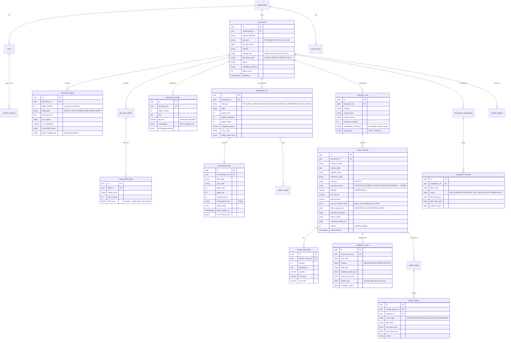

# Database schema

PostgreSQL 17 + pgvector 0.8. The schema is created only by Alembic migrations
(`backend/alembic/versions/`); a test asserts that models and migrated schema match.

## Entity-relationship diagram

## How the assignment's data maps to tables

| Requirement | Tables |
|---|---|
| Document metadata | `documents`, `storage_objects` |
| Extracted text | `document_pages.extracted_text` (+ S3 for very long pages), `spreadsheet_rows`, `document_tables` |
| Structured results | `invoice_records`, `invoice_line_items`, `extraction_runs` (immutable machine output) |
| Validation errors | `validation_issues`, `review_tasks` |
| Processing history | `processing_runs` (stage history, progress, errors), `processing_tasks` (attempts, error history), `review_actions`, `audit_events` |
| Search | `document_chunks` (full-text `tsvector` + `vector(1024)`) |

## Design rules

* **Money**: `NUMERIC(20,4)` (quantities and prices `NUMERIC(20,6)`), never
  floats; APIs return decimal strings.
* **Tenant consistency**: every tenant table has `organization_id`; children
  reference `documents (organization_id, id)` through a composite foreign key,
  so a row can never belong to another tenant's document.
* **History is never overwritten**: re-extraction supersedes invoice records
  (`superseded_at`) instead of deleting them; human corrections are stored in
  `review_actions` with old and new values; `audit_events` is append-only
  (a database trigger rejects UPDATE/DELETE).
* **Idempotency keys**: `processing_tasks.idempotency_key` (run + stage + page
  range), `document_pages (document_id, page_number)`, and a partial unique
  index allowing one open review task per invoice.

## Indexes

| Index | Purpose |
|---|---|
| `documents (organization_id, created_at DESC) WHERE deleted_at IS NULL` | listing |
| `documents (organization_id, status)`, `(organization_id, sha256)` | status filters, duplicate files |
| `document_chunks USING gin (text_tsv)` | keyword search |
| `document_chunks USING hnsw (embedding vector_cosine_ops)` | semantic search |
| `invoice_records (organization_id, normalized_supplier, normalized_invoice_number) WHERE superseded_at IS NULL` | duplicate invoices |
| `processing_runs (updated_at) WHERE state NOT IN (terminal)` | recovery sweeps |
| `processing_tasks (lease_expires_at) WHERE task_state='RUNNING'` | expired leases |
| `outbox_events (available_at) WHERE published_at IS NULL` | dispatcher poll |
| `validation_issues (document_id) WHERE resolution_status='OPEN'` | open issues |

Vector search uses `hnsw.iterative_scan = relaxed_order` so tenant-filtered
queries still return enough neighbours; the tenant filter is part of the
candidate query itself.
