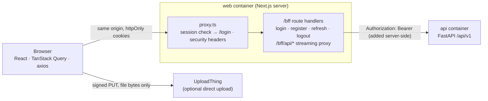

# Frontend

An internal web app for finance analysts and reviewers: upload documents,
follow processing, review extracted invoices next to the page image with
evidence boxes, correct and approve, reconcile PDF↔PDF and PDF↔Excel, and
search. Source: [`frontend/`](../frontend).

## Stack

| Concern | Choice |
|---|---|
| Framework | Next.js 16 (App Router, standalone output), React 19, TypeScript strict |
| UI | shadcn/ui (Base UI primitives + Tailwind CSS v4), lucide icons, `next-themes` (light / dark / system, no flash) |
| Server state | TanStack Query v5: one cache, deduplicated requests, polling only while a job is running |
| URL state | `nuqs` (filters, search, pagination survive reloads and links) |
| Forms | `react-hook-form` + `zod` |
| HTTP | axios against the same-origin BFF (`/bff/api/v1`) |
| API types | `openapi-typescript`, generated from the backend schema (`make api-types`) |
| Tests | Vitest + Testing Library + MSW (unit/component), Playwright + axe (end-to-end, accessibility) |

## Request flow (Backend-for-Frontend)



* **Tokens never reach JavaScript.** The BFF stores the access token (`di_at`,
  15 min) and the refresh token (`di_rt`, path `/bff/auth` only) in
  `httpOnly; SameSite=Lax` cookies (`Secure` when `COOKIE_SECURE=true`), and
  adds the `Authorization` header when it forwards a request to the API.
* **One refresh at a time, across tabs.** A `TOKEN_EXPIRED` response triggers
  a refresh guarded by an in-tab promise and `navigator.locks`; the original
  request is replayed once. Logout is broadcast to other tabs
  (`BroadcastChannel`).
* **CSRF.** State-changing requests must carry `X-Requested-With: docintel`
  (a custom header a cross-site form cannot send without a CORS preflight,
  which the BFF never grants), or come from exactly `APP_ORIGIN`
  ([`lib/auth/origin.ts`](../frontend/lib/auth/origin.ts)).
* **Only the API is reachable through the proxy**: paths outside `v1/` and
  `health` are rejected. Bodies are streamed both ways, so large uploads and
  CSV exports are never buffered in the web server.
* The browser therefore talks to one origin only; the API does not need to be
  exposed publicly in production.

## Data correctness in the UI

* Money is formatted from the API's decimal strings, never with float
  arithmetic. A `null` currency is shown with the printed symbol and an
  "unconfirmed" badge, never as a default currency.
* Corrections, approvals and rejections send `expected_version`; a
  `409 VERSION_CONFLICT` opens a side-by-side diff instead of overwriting.
* Uploads and comparisons send an `Idempotency-Key`, so retries and double
  clicks never create duplicates.
* Query keys are centralised (`lib/api/keys.ts`) and every mutation
  invalidates exactly the affected keys (`lib/api/invalidation.ts`).

## Code layout

```
frontend/
  app/
    (auth)/          login, register
    (app)/           documents, invoices, reviews, compare, jobs, search, admin
    bff/             auth route handlers, API proxy, health
  features/<area>/   api.ts (typed calls) + hooks.ts (TanStack Query) per domain
  components/        app shell and shared components; ui/ = shadcn primitives
  lib/               api client, errors, query keys, auth helpers, env, formatting
  hooks/             shared React hooks
  proxy.ts           route guard + security headers (Next 16 "proxy", formerly middleware)
  tests/             Vitest unit and component tests (MSW mocks the API)
  e2e/               Playwright workflows and accessibility checks
```

## Configuration

| Variable | Used by | Meaning |
|---|---|---|
| `API_INTERNAL_URL` | BFF (server only) | Where the API is reachable from the web server (`http://api:8000` in Compose) |
| `APP_ORIGIN` | BFF | Public origin of the web app, for the CSRF check |
| `COOKIE_SECURE` | BFF | `true` behind HTTPS |
| `NEXT_PUBLIC_APP_NAME` | browser | Display name |

In Compose these come from the root `.env`. For `make web-dev` on the host,
`frontend/.env.local` (copied from `frontend/.env.example`) is used.
