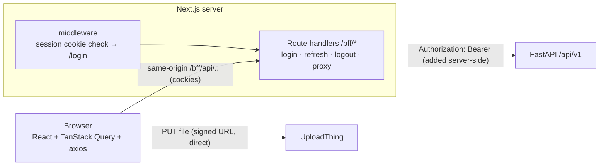

# DocIntel AI — Web Application

DocIntel AI is a production-grade, internal web application designed for finance analysts and reviewers: upload documents → monitor real-time processing → review extracted invoices with bounding-box evidence overlays → correct and approve → compare and reconcile → search across OCR text and extracted fields.

Built strictly according to [`frontend-plan.md`](./frontend-plan.md).

---

## 1. Stack & Technologies

* **Framework**: Next.js 16 (App Router, current stable), React 19, TypeScript strict (no `any`).
* **UI**: shadcn/ui only (Radix / Base UI primitives + Tailwind CSS v4), `lucide-react` icons.
* **Theming**: `next-themes` with zero flash on load, defaulting to system theme.
* **State & Data**:
  * **Server State**: TanStack Query v5 (deduplicated queries, stale-while-revalidate, adaptive polling).
  * **URL State**: `nuqs` (type-safe query parameters for search, filters, and pagination).
  * **Forms**: `react-hook-form` + `zod` validation.
  * **Virtualization & Tables**: TanStack Table v9 + TanStack Virtual v3.
  * **HTTP Client**: Axios with custom interceptors for request tracing (`X-Request-ID`), CSRF protection (`X-Requested-With: docintel`), and single-flight token refresh.
* **API Typing**: `openapi-typescript` generated from `/openapi.json` into `lib/api/schema.d.ts`.
* **Testing**: Vitest, React Testing Library, MSW v3, Playwright, `@axe-core/playwright`.

---

## 2. Architecture



### 2.1 Backend-for-Frontend (BFF) & Auth
- **Tokens in httpOnly cookies**: Browser JavaScript never has access to access or refresh tokens. The BFF sets `di_at` (15 min access) and `di_rt` (14 days refresh, path `/bff/auth`) as `httpOnly; Secure; SameSite=Lax` cookies.
- **Single-flight token refresh across tabs**:
  - In-tab mutex promise prevents multiple simultaneous refresh calls.
  - Cross-tab mutex uses `navigator.locks.request("docintel-refresh")` checking `di_at_exp`.
  - Proactive refresh runs ~60 seconds before expiration when the tab is visible.
  - Multi-tab logout synchronisation via `BroadcastChannel("docintel-auth")`.
- **Streaming proxy**: `/bff/api/[...path]` streams request/response bodies without server buffering for large uploads and CSV/ZIP downloads.
- **CSRF Defense**: Enforces `Origin` matches application origin and requires `X-Requested-With: docintel`.

### 2.2 Data Integrity
- **Exact Money Formatting**: Currency and amounts are preserved as exact decimal strings without converting to floating-point numbers (`formatMoney` in `lib/format.ts`).
- **Optimistic Concurrency**: Field corrections, approvals, and rejections send `expected_version`. If another reviewer updated the invoice concurrently, a `409 VERSION_CONFLICT` dialog displays a side-by-side field diff.
- **Idempotency**: Document uploads and comparison jobs pass `Idempotency-Key: crypto.randomUUID()` to prevent duplicate operations on network retries or double clicks.

---

## 3. Getting Started

### Prerequisites
- Node.js 22+
- `pnpm` 10+ (`corepack enable` or installed globally)

### Environment Setup
Copy `.env.example` to `.env.local`:
```bash
cp .env.example .env.local
```
Key configuration variables:
```bash
API_INTERNAL_URL=http://localhost:8000
APP_ORIGIN=http://localhost:3000
COOKIE_SECURE=false
NEXT_PUBLIC_APP_NAME="DocIntel AI"
```

### Installation and Development
```bash
# Install dependencies
pnpm install --frozen-lockfile

# Run dev server
pnpm run dev

# Open http://localhost:3000
```

---

## 4. Verification & Testing

```bash
# Typecheck (TypeScript strict, noEmit)
pnpm run typecheck

# Code quality and linting
pnpm run lint

# Unit & MSW Component Tests
pnpm test

# End-to-End & Accessibility Tests (Playwright + Axe-Core)
pnpm run test:e2e

# Production Build
pnpm run build
```

### Regenerating API Schema Types
When the FastAPI backend schema changes:
```bash
curl -sf http://localhost:8000/openapi.json -o openapi.json
pnpm exec openapi-typescript openapi.json -o lib/api/schema.d.ts
```

---

## 5. Docker Deployment

DocIntel frontend is configured for standalone production containerization:
```bash
# Build Docker image
docker build -t docintel-web:latest .

# Run container
docker run -p 3000:3000 \
  -e API_INTERNAL_URL=http://host.docker.internal:8000 \
  -e COOKIE_SECURE=false \
  docintel-web:latest
```

In the main repository `compose.yaml`:
```bash
docker compose up -d web
```
The container exposes port `3000` and includes an automated health check verifying `/bff/health`.
